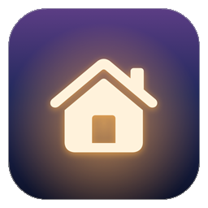
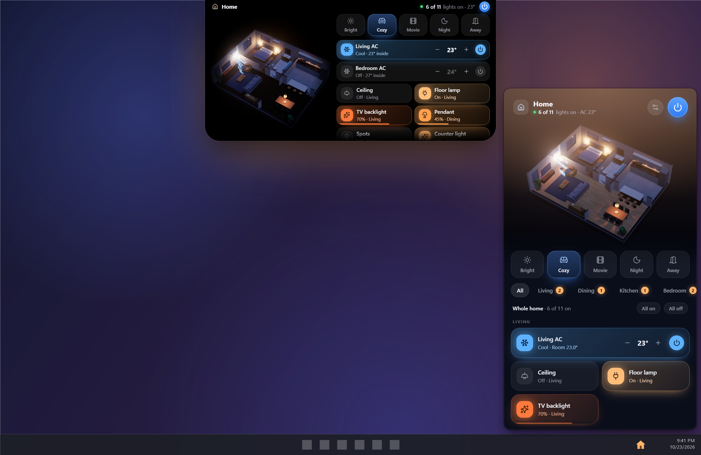
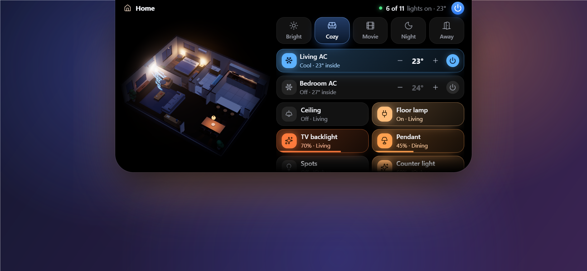
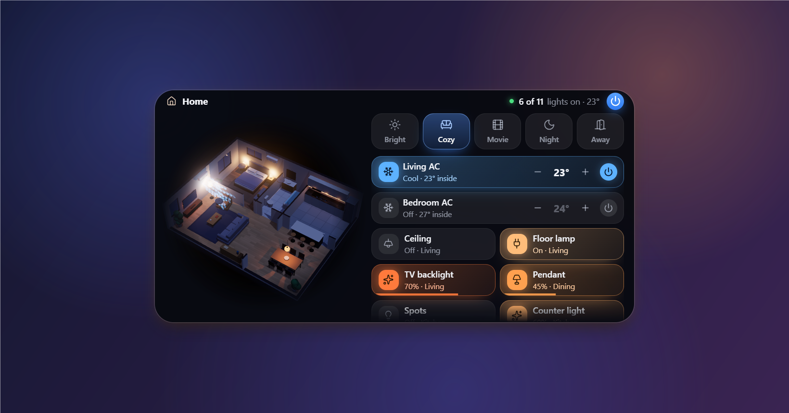
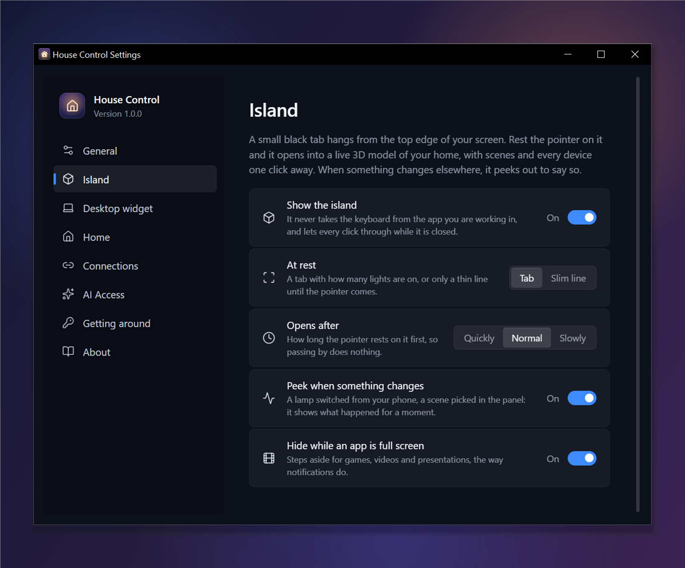
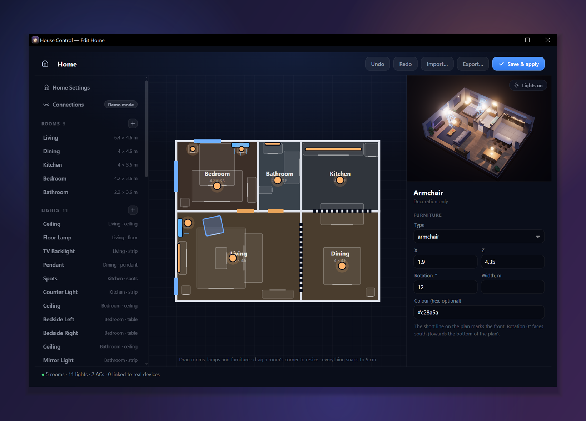

<p align="center">
  
</p>

<h1 align="center">House Control for Windows</h1>

<p align="center">
  Your home as a live 3D model — above the taskbar, at the top of your screen and on your desktop —<br>
  controlling its lights and air conditioners through Smart Life, Home Assistant and Philips Hue.
</p>

<p align="center">
  <a href="#download"><b>Download</b></a> &nbsp;·&nbsp;
  <a href="#build-it-yourself"><b>Build it yourself</b></a> &nbsp;·&nbsp;
  <a href="https://github.com/0xProbabillity/house-control"><b>Mac and iPhone</b></a>
</p>

<p align="center">
  
</p>

## What it does

- **Lives in the taskbar.** Click the house in the notification area — or House Control pinned to the taskbar — and
  the panel slides up like Windows' own flyouts; click anywhere else and it is gone. `Ctrl+Alt+H` opens it from anywhere.
- **Your floor plan in 3D.** Rooms, walls, doors, windows and furniture are built from one JSON file.
  Lamps light the scene the way they light the room; an AC that is running blows visible air.
- **Lights.** Click to toggle, drag across a tile to dim, open a light for brightness, white temperature and colour.
- **Air conditioners.** Power, target temperature, mode and fan speed, with the room temperature from a real sensor if you have one.
- **Scenes.** One click sets every light and AC — "Cozy", "Movie", "Night", or your own — from the panel, the tray
  icon's menu, or the jump list of the pinned taskbar button.
- **An island at the top of the screen.** Rest the pointer on a small black tab at the top edge and a live model of
  the home springs out of it, with scenes and every device one click away. See [The island](#the-island).
- **A desktop widget.** The home in 3D on your desktop, under every window, live. See [Desktop widget](#desktop-widget).
- **A visual editor.** Draw the rooms, drop in furniture, place lamps and ACs, and link each one to a real device.
- **Your devices, wherever they live.** Smart Life / Tuya, Home Assistant (and the thousands of brands it runs) and
  Philips Hue — mixed freely in one home. See [Connect real devices](#connect-real-devices).
- **AI Access.** Give ChatGPT, Claude or any AI assistant a private link — or connect it over MCP — and it runs your
  lights and air conditioners, and rebuilds rooms in the 3D model from your photos. Served by your PC; Stop ends it.
  See [AI Access](#ai-access).
- **Your phone in step.** Pair the House Control iPhone or Android app with your PC and the floor plan, the device links and
  the Home Assistant and Hue connections stay the same on both. See [iPhone and Android app](#iphone-and-android-app).
- **Works without any hardware.** Until you sign in, every device is simulated, so you can try everything first.

It is a small native shell in C# (.NET 8, Win32 and WinForms) around the same [Three.js](https://threejs.org) web UI
as the Mac app, drawn by Microsoft Edge WebView2. The panel, the island and the widget are transparent windows
composited by the GPU through DirectComposition, so they have real rounded corners and soft shadows over whatever is
behind them. No Electron, no server, no account of its own.

## Download

1. Get `HouseControl-<version>-setup-x64.exe` from [Releases](https://github.com/0xProbabillity/house-control-windows/releases)
   (`-arm64` for Windows on Arm). It runs on Windows 10 (1809 or newer) and Windows 11.
2. Run it. It installs for your account only — no administrator prompt — into
   `%LOCALAPPDATA%\Programs\House Control`.
3. The first time, Microsoft Defender SmartScreen may say *“Windows protected your PC”*, because the installer is
   not signed with a paid code-signing certificate (see [why](#why-the-installer-is-not-signed)). Click
   **More info → Run anyway**.
4. Look for the house in the notification area at the right of the taskbar. On Windows 10 new icons start in the
   overflow (**˄**): drag it onto the taskbar to keep it in sight.

Rather not install anything? `HouseControl-<version>-win-x64.zip` is the same app: unzip it anywhere and run
`HouseControl.exe`.

It starts with a bundled demo plan, so you can try everything before connecting anything. Then:
[make it your home](#make-it-your-home) and [connect real devices](#connect-real-devices).

House Control needs the Microsoft Edge WebView2 Runtime, which Windows 11 and up-to-date Windows 10 already have;
if it is missing, the app says so and links to Microsoft's download.

### Check what you downloaded

Every release is built by [GitHub Actions](.github/workflows/release.yml) from the tagged commit — not on anyone's
PC — and comes with its SHA-256:

```powershell
Get-FileHash .\HouseControl-1.0.0-setup-x64.exe -Algorithm SHA256
Get-Content .\HouseControl-1.0.0-setup-x64.exe.sha256
```

### Why the installer is not signed

A code-signing certificate that SmartScreen trusts costs hundreds of dollars a year and carries a person's or a
company's legal name in every copy. House Control earns trust the open-source way instead: the code is all here,
the release is built in public, and you can [build it yourself](#build-it-yourself) in a few minutes.

### Remove it

**Settings → Apps → Installed apps → House Control → Uninstall**. To remove your plan and connections too, delete
`%APPDATA%\HouseControl`.

## Using it

| Do this | To get this |
| --- | --- |
| Click the tray icon, or press `Ctrl+Alt+H` | Open or close the panel |
| Right-click the tray icon | Scenes, all lights, Edit Home, the island, the widget, Start with Windows, AI Access, Settings, Quit |
| Pin House Control to the taskbar, click it | The panel opens right above the button |
| Right-click the pinned button | Your scenes, Turn all lights off, Edit home, Settings |
| Click a lamp in the 3D view, or its tile | Toggle it |
| Drag sideways across a light tile | Dim it |
| Click the sliders icon on a light tile | Brightness, white temperature, colour |
| Click an AC, or its tile | Open its sheet: temperature, mode, fan speed |
| Click a room | Zoom in on it and list only its devices |
| Drag the 3D view / scroll over it | Rotate / zoom |
| `Esc` | Back, then close |
| `Ctrl+,` | Settings |

The tray icon is a house that lights up warm when lights are on, with how many in a small badge, and its tooltip
says what is on: `6 of 11 lights on · AC 23°`.

### Pin it to the taskbar

Open Start, right-click **House Control → Pin to taskbar**. A click on the pinned button opens the panel above it;
a right-click shows its jump list — the home's scenes and the everyday commands — like any Windows app. The
running app keeps living in the tray, so the button never fills up with windows.

## The island

<p align="center">
  
</p>

Windows laptops have no notch, so House Control draws one: a small black tab at the top centre of the screen,
where the title bars of maximised windows meet the edge.

| Do this | To get this |
| --- | --- |
| Look at it | How many lights are on, and the target of a running AC |
| Rest the pointer on it | It springs open: the 3D model, scenes, air conditioners and lights |
| Click a lamp in the model, or its chip | Toggle it; drag across a chip to dim |
| Click a room in the model | Zoom in on it |
| Move the pointer away | It closes |

When something changes elsewhere — a scene picked in the panel, a lamp switched from the Hue app, an AI assistant at
work — the island peeks out for a moment to say what happened. It never takes the keyboard from the app you are
working in, lets every click through while it is closed, and steps aside while a full-screen app, a game or a
presentation is in front, the way Windows' own notifications do.

Everything about it is in **Settings → Island**: a **Tab** with what is on or only a **Slim line** at rest, how long the
pointer rests before it opens, peeking, full-screen behaviour, and which display it lives on. **Show Island** in the
tray icon's menu turns it off.

## Desktop widget

<p align="center">
  
</p>

Turn on **Desktop Widget** in the tray icon's menu (or **Settings → Desktop widget**) and the open island becomes a
card on your desktop: under every window, and right there when you show the desktop (`Win+D`). Drag it by its
title to move it; it remembers where it was put. **Lock its position** keeps it from moving.

It draws only when something changes, so it costs nothing while you work.

## iPhone and Android app

The [House Control iPhone app](https://github.com/0xProbabillity/house-control#iphone-app) and the
[Android app](https://github.com/0xProbabillity/house-control-android) pair with a PC exactly as they pair with a Mac:

1. On the PC: right-click the tray icon → **Pair Phone…** (or **Settings → Phone → Pair…**). A QR code appears.
2. On the phone: **Settings → Pair with Mac or PC** (**Pair with Mac** in older versions), and point the camera at
   the code. Or press **Copy Pairing Link** on the PC and paste it on the phone.

From then on, whenever both are on the same network and the app is open on the phone, a plan saved on one reaches
the other a moment later, whichever one you edit; a home set up on the phone first comes to the PC when you pair
them. The Home Assistant and Hue connections travel too (the newer side wins), the phone sends its Apple Home
devices so you can link them in the editor, and when the phone signs in to Smart Life it can show its sign-in code
on the PC's screen.

The two talk directly: the PC announces itself on the network with multicast DNS (as a Mac does with Bonjour), and
the connection is TLS with a pre-shared key that only the QR code carries, so a device that never saw the code
cannot connect. **Reset Pairing…** issues a new key.

The first time, Windows asks whether House Control may use the network: allow it. If your Wi-Fi is set as a
**public** network in Windows, the phone cannot reach the PC — switch it to **private** (Settings → Network &
internet → Wi-Fi → your network → **Private network**), which is what it is at home anyway.

## Settings

<p align="center">
  
</p>

**Settings…** in the tray icon's menu (or `Ctrl+,` in the panel) has everything in one place: Start with Windows,
the keyboard shortcut (click it and press a new one), the tray badge, the island (its width and how see-through it
is), the desktop widget, your floor plans, the connections, phone pairing, AI Access and a list of every shortcut.

**Start with Windows** adds House Control to your account's startup apps; Task Manager's **Startup apps** tab can
switch it off too, and Settings shows when it has.

## AI Access

Right-click the tray icon → **AI Access…** → **Start AI Access**, and hand the private link to an assistant:

- **Any chat:** paste it into ChatGPT, Claude, Gemini or Perplexity with your request — *"dim the living room to 30%"*.
  The link opens a guide written for AI assistants, with an action link for everything it can do.
- **Connectors:** add the MCP address as a custom connector in Claude or ChatGPT (or `claude mcp add` in Claude Code)
  and the assistant can also change the home itself: *"here are photos of my living room — rebuild it in 3D"*.
- **Your own agents:** the same tools as plain HTTP + JSON, with an OpenAPI description.

Your PC serves it all: House Control listens on `127.0.0.1` only and is reached through a Cloudflare quick tunnel that
exists while AI Access is on (or not at all, with **This PC only**). The link carries a 128-bit key, you choose what an
assistant may do, every request shows up live in the window, plan edits can be undone, and **Stop** — or the
auto-stop timer — makes the address disappear. Device IDs and sign-ins never leave the PC.

Details, every tool, and the privacy model: [docs/ai-access.md](docs/ai-access.md).

## Make it your home

Right-click the tray icon and choose **Edit Home…**

<p align="center">
  
</p>

- Drag rooms to move them and drag a corner to resize; everything snaps to 5 cm.
- Where two rooms touch, the wall between them appears by itself. Walls facing the camera are cut away.
- Add doors, windows, furniture, lamps and air conditioners from the list on the left.
- **Save & apply** (`Ctrl+S`) writes the plan and reloads the panel, the island and the widget. `Ctrl+Z` / `Ctrl+Y` undo and redo.

The plan is a single JSON file, `%APPDATA%\HouseControl\plan.json`. You can write it by hand, export it, or import
someone else's: see [docs/floor-plan.md](docs/floor-plan.md) for every field. The demo plans in
[`web/public/plans`](web/public/plans) are good starting points, and plans move freely between the Windows and the
Mac app.

## Connect real devices

Right-click the tray icon → **Edit Home… → Connections**, and connect what you have:

| Platform | How | Details |
| --- | --- | --- |
| **Smart Life / Tuya** | Scan a QR code with the Smart Life app. No Tuya developer account | [docs/smart-life.md](docs/smart-life.md) |
| **Home Assistant** | Found on your network by itself; paste a long-lived access token | [docs/connections.md](docs/connections.md#home-assistant) |
| **Philips Hue** | Found on your network by itself; press the button on the bridge | [docs/connections.md](docs/connections.md#philips-hue) |

Then select a lamp or an AC on the plan, choose its device under **Real device**, and press **Save & apply**. From
then on the panel controls the real device. Changes made elsewhere show up at once from Home Assistant and Hue, and
within 12 seconds from Smart Life. Apple Home accessories can come in through Home Assistant — see
[docs/connections.md](docs/connections.md#apple-home).

## Privacy

House Control talks to the platforms you connect — Tuya's servers for Smart Life, your own Home Assistant, your Hue
Bridge — and to nothing else. There is no telemetry and no backend of its own. The one exception is yours to switch
on: [AI Access](#ai-access) opens a Cloudflare tunnel to your PC while it is on.

Everything personal stays in `%APPDATA%\HouseControl\` on your PC:

| File | Contents |
| --- | --- |
| `plan.json` | Your floor plan, including the IDs of the devices you linked |
| `settings.json`, `app-settings.json`, `windows.json` | Which plan is active; the island, widget and shortcut settings; window positions |
| `smartlife.json`, `tuya.json` | The Smart Life session and Tuya Cloud credentials. Encrypted for your Windows account (DPAPI) |
| `homeassistant.json` | Your Home Assistant's address and access token. Encrypted |
| `hue.json` | Your Hue Bridge's address, the key it issued and its certificate's fingerprint. Encrypted |
| `events.log` | Commands sent to real devices and the cloud's answers. No tokens |
| `app.log` | The app's own diagnostics, such as script errors. No tokens |
| `agent.json`, `bin\cloudflared.exe` | AI Access settings, and Cloudflare's connector if you let the app download it |
| `sync.json` | The key your paired phones use. Only there once you paired one. Encrypted |
| `homekit-devices.json`, `connections-sync.json` | The Apple Home devices your iPhone listed for the editor (names and ids); when each shared connection last changed |

The web views keep their own small profile (window state, the last panel state) in `%LOCALAPPDATA%\HouseControl\WebView2`.
None of these are part of this repository, and the build does not embed them in the app.
**Sign out** in the editor deletes the Smart Life session. Deleting the folder resets the app to the demo plan.

## Build it yourself

| | |
| --- | --- |
| Windows | 10 (1809) or newer, x64 or Arm64 |
| .NET SDK | 8.0 — `winget install Microsoft.DotNet.SDK.8` |
| Node.js | 20.19+ or 22.12+ — `winget install OpenJS.NodeJS.LTS` |
| For the installer | Inno Setup 6 — `winget install JRSoftware.InnoSetup` |

```powershell
git clone https://github.com/0xProbabillity/house-control-windows.git
cd house-control-windows
powershell -ExecutionPolicy Bypass -File scripts\build.ps1
```

The script builds the web UI with Vite, runs the tests, publishes a self-contained app for x64 and Arm64 (no .NET
needed on the PC that runs it) and packs each into an installer and a portable zip in `dist\`. `-Arch x64` builds
one architecture, `-SkipInstaller` skips Inno Setup.

For day-to-day work:

```powershell
cd web; npm install; npm run build; cd ..
dotnet run --project src\HouseControl
```

## Development

```
web/        the UI: Three.js scene, panel, island, widget, editor, Settings, AI Access window (Vite, plain ES modules)
src/
  HouseControl.Core/   plans, the device hub, Smart Life / Tuya, Home Assistant, Philips Hue, network discovery and
                       the AI Access gateway (.NET 8 class library)
  HouseControl/        the Windows shell: tray icon, panel, island, desktop widget, jump list, shortcut, windows
tests/      the core's tests (xUnit), including the platforms against in-process fake servers
installer/  the Inno Setup script
scripts/    build.ps1 builds everything; make-icon.ps1 draws the app icon from assets/
docs/       floor plan reference, connection guides, screenshots
```

```powershell
dotnet test tests\HouseControl.Core.Tests
```

Work on the UI in a browser with hot reload — the native bridge is a no-op there and all devices are simulated:

```powershell
cd web
npm install
npm run dev
```

Then open `http://localhost:5199/`. Add `?plan=studio` for the second demo plan, `?mode=editor` for the editor,
`?mode=island` for the island (`&rest=slim` for the slim line), `?mode=widget` for the desktop widget,
`?mode=settings` for Settings, `?mode=agent` for the AI Access window, or `?device=living.ac` to start on a
device's sheet.

Environment variables understood by the app:

| Variable | Effect |
| --- | --- |
| `HOUSE_DEV_URL=http://localhost:5199/` | Load the UI from the dev server instead of the bundle |
| `HOUSE_WEB_DIR=C:\path\to\dist` | Load the UI from another folder |
| `HOUSE_DATA_DIR=C:\some\folder` | Keep plan, sessions and logs there instead of `%APPDATA%\HouseControl`. Handy for a clean test run |
| `HOUSE_DEVTOOLS=1` | Allow the browser developer tools (F12) and context menus in every view |
| `HOUSE_OPEN_ON_LAUNCH=1` | Open the panel at launch |
| `HOUSE_OPEN_EDITOR=1` | Open the editor at launch (`connections`, `smartlife`, `homeassistant` or `hue` opens it on that screen) |
| `HOUSE_OPEN_SETTINGS=1` | Open Settings at launch (or a pane: `island`, `widget`, `connections`…) |
| `HOUSE_OPEN_DEVICE=<id>` | Start the panel on that light's or AC's sheet |
| `HOUSE_PIN=1` | Keep the panel open when it loses focus |
| `HOUSE_ISLAND=0` | Run without the island (`1` forces it on) |
| `HOUSE_ISLAND_EXPANDED=1` | Keep the island open |
| `HOUSE_SNAPSHOT_DIR=C:\some\folder` | Write `panel.png`, `island.png`, `widget.png`, `settings.png` and `editor.png` there a few seconds after launch (`HOUSE_SNAPSHOT_DELAY` seconds, 6 by default) |
| `HOUSE_OPEN_PAIRING=1` | Open the Pair Phone window at launch |
| `HOUSE_COMPUTER_NAME="Studio PC"` | The name paired phones see, instead of the PC's own |
| `HOUSE_OPEN_AGENT=1` | Open the AI Access window at launch (`start` also starts the link) |
| `HOUSE_AGENT_REACH=local` | Serve AI Access on this PC only for one run (`internet` for the tunnel) |
| `HOUSE_AGENT_LINK_FILE=C:\some\file` | Write the live AI Access link there, for scripted tests |
| `HOUSE_EVAL_DIR=C:\some\folder` | Scripted UI checks: a `panel.js` / `island.js` / `widget.js` / `editor.js` / `settings.js` / `agent.js` dropped there runs in that page (as an async function body) and its result is written to `<mode>.json` |

For example, a throw-away instance on the demo plan, pinned open:

```powershell
$env:HOUSE_DATA_DIR = "$env:TEMP\house-demo"; $env:HOUSE_PIN = 1; $env:HOUSE_OPEN_ON_LAUNCH = 1
dotnet run --project src\HouseControl
```

The executable has a few offline self-checks and one read-only diagnostic, printed to the console it was started from:

| Command | Prints |
| --- | --- |
| `HouseControl.exe --selftest-mapper` | The Tuya commands built for typical light and AC actions |
| `HouseControl.exe --selftest-infrared` | The key presses sent to an infrared AC, against a simulated cloud remote |
| `HouseControl.exe --selftest-transport` | The Smart Life request envelope for fixed inputs, to compare with the reference SDK |
| `HouseControl.exe --diagnose <device id>…` | What Smart Life reports for those devices. Reads only; sends nothing |

It also takes `--open`, `--scene <id>`, `--all-off`, `--all-on`, `--edit`, `--settings`, `--ai` and `--quit`, handed
to the copy that is already running — that is what the jump list uses, and what your own shortcuts or scripts can use.

### Releasing

Set `<Version>` in `src/HouseControl/HouseControl.csproj`, add a `## <version> — <date>` section to
[CHANGELOG.md](CHANGELOG.md) (it becomes the release notes), commit, then tag and push:

```powershell
git tag v1.0.0; git push origin v1.0.0
```

[`release.yml`](.github/workflows/release.yml) builds the installers and zips on a GitHub Windows runner and opens a
**draft** release with them and their SHA-256. Check it, then publish the draft.

## Limitations

- The PC and the phone sync only while both are on the same network; there is no cloud in between.
- Apple Home accessories are reached through Home Assistant only (Apple keeps HomeKit to its own devices).
- The Windows 11 Widgets board takes widgets only from apps installed from the Microsoft Store, so House Control's
  widget lives on the desktop instead.
- Rooms are axis-aligned rectangles. An L-shaped room is two rooms.
- Smart Life devices are reached through Tuya's cloud, not over the local network, so they need an internet
  connection (Home Assistant and Hue work on your network alone).
- Infrared air conditioners are one-way: the app shows what was last sent, not what the unit is doing.

## Support the project

House Control is free and has no ads. A star, a bug report or a pull request helps a lot — and if it earned a place
on your taskbar, the [Mac app's page](https://github.com/0xProbabillity/house-control#support-the-project) has ways to
leave a tip. Thank you!

## Acknowledgements and disclaimer

The Smart Life sign-in is a port of Tuya's open-source
[`tuya-device-sharing-sdk`](https://github.com/tuya/tuya-device-sharing-sdk), the library behind the Tuya
integration in Home Assistant, and identifies itself to Tuya the same way. The 3D view is built with
[Three.js](https://threejs.org); the icons are from [Lucide](https://lucide.dev); QR codes are drawn by
[QRCoder](https://github.com/codebude/QRCoder).

This project is not affiliated with or endorsed by Microsoft, Tuya, Smart Life, Home Assistant or Signify (Philips Hue).
It relies on an interface Tuya can change at any time. Use it at your own risk.

## License

[MIT](LICENSE)
